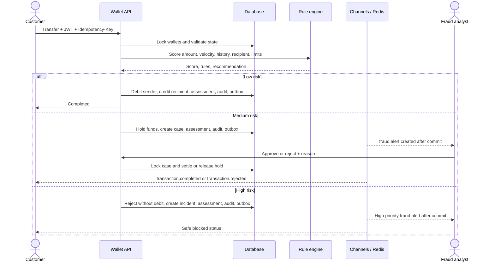

# Wallet fraud workflow

## Current implementation

The existing `wallets` app owns transfers and balance updates. It locks both
wallet rows in primary-key order, uses decimal amounts, stores transfer
idempotency keys, and atomically holds or moves funds. The fraud rules in
`apps/wallets/fraud.py` run before any transfer balance change. A transfer now
also writes an append-only `RiskAssessment` and system `AuditLog` in that same
database transaction. Medium scores open a review case and hold sender funds;
high scores reject the transaction and open an investigation incident. Low
scores complete the transfer. The configured defaults are 30 (review) and 70
(block), and `WALLET_SETTINGS` can override thresholds and weights.

The `fraud` app owns analyst permissions, cases, reviews, audit records, and a
durable notification outbox. Outbox events are written with the financial
change and pushed to Channels only after commit. A failed WebSocket push does
not undo a transfer; clients can recover customer events at
`GET /api/v1/fraud/notifications/?after=<event-id>` and analyst alerts at
`GET /api/v1/fraud/alerts/?after=<event-id>`. Customer WebSockets are
available at `/ws/transactions/`; authorized analyst WebSockets at `/ws/fraud/`.
Obtain a short-lived, one-use ticket with `POST /api/v1/fraud/ws-ticket/` and
connect with that ticket. Customers only join their own server-derived group.

Case APIs are under `/api/v1/fraud/cases/`;
analyst access reuses Django's `wallets.review_transaction` permission.
Reviews require a decision and reason. A case lock and unique review constraint
prevent duplicate decisions. Blocked incidents cannot be approved from the
review API.

## Sequence



## Setup and migration

Copy `.env.example` to `.env`, set the required application and database
values, then use the existing virtual environment:

```sh
cd fintech
cp .env.example .env
../venv/bin/pip install -r requirements.txt
../venv/bin/python manage.py migrate
../venv/bin/python manage.py runserver
```

The production settings currently use MySQL, not PostgreSQL. The migration is
database portable, but switching to PostgreSQL requires a database settings
change and driver/deployment configuration. Redis is used by production cache
and Channels settings. The test settings use SQLite, local memory cache, and
an in-memory Channels layer and do not require Redis.

Run tests from `fintech/` with `../venv/bin/pytest -q`.

After migrating, create the analyst groups with
`../venv/bin/python manage.py setup_fraud_roles`, then assign users to
`FRAUD_ANALYST` or `FRAUD_ADMIN` through the trusted Django admin/operator
workflow. Customers must not receive these permissions.

## API examples

Initiate a saved-beneficiary transfer:

```http
POST /api/v1/wallet/transfer/
Authorization: Bearer <access-token>
Idempotency-Key: transfer-unique-client-key
Content-Type: application/json

{"beneficiary":"<beneficiary-uuid>","amount":"1250.00","description":"Invoice 42"}
```

Review a case (analyst permission required):

```http
POST /api/v1/fraud/cases/<case-reference>/review/
Authorization: Bearer <analyst-access-token>
Content-Type: application/json

{"decision":"reject","reason":"Customer confirmed this was not their transfer."}
```

## Limits and deployment checks

- This checkout has no React/Vite frontend, Docker deployment, PostgreSQL
  configuration, or deployment runbook. Those deliverables remain to be built.
- Redis/WebSocket integration is configured in production settings; automated
  tests use in-memory adapters. A Redis outage does not affect persisted
  transfers or event recovery, but a separate Redis outage integration test
  is still needed.
- Transfers are assessed synchronously. M-Pesa deposits are handled by the
  existing payment callback flow and are not yet passed through this fraud
  assessment/case pipeline. Daraja callbacks use the configured secret callback
  URL and should be checked against current provider security guidance before
  production use.
- `AppendOnly` prevents ordinary ORM instance updates/deletes; it is not a
  database-level tamper-proof audit guarantee. Production should restrict DB
  roles and add retention, access monitoring, and backup controls.
- Production deployment still needs security checks, HTTPS/origin settings,
  monitoring, operational review queues, and independent financial/security
  review. This implementation is not a production-readiness claim.
